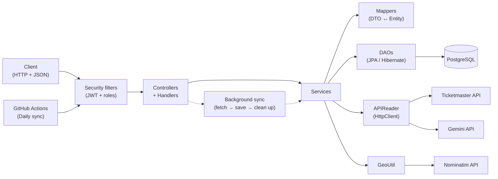
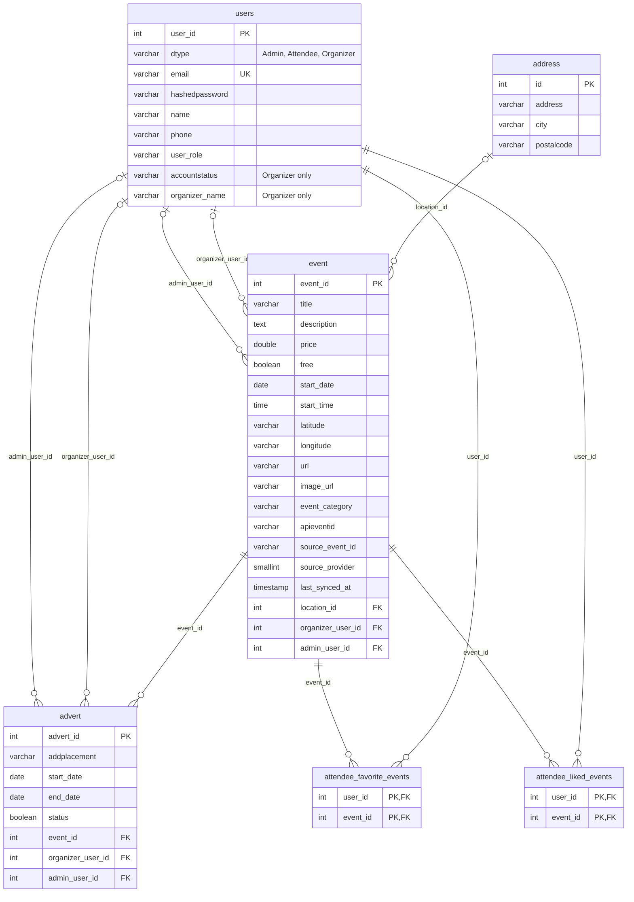

# seeCph - REST API

seeCph is a REST API that gathers events in Copenhagen in one place. Events are fetched automatically from API every night and can also be created by approved organizers and admins. Users can search and filter events, save favourites and like events, and organizers can advertise their events on the front page. Searching events is also possible without registration, to make the interaction for users easier.

## Links

**Live API:** https://seecph.theisrud.dk/api/v1/events?page1

**Project Blog:** https://theisrud.dk/blog/seecph-blog/

The domain model, user stories and class diagram can be found in the [`docs`](docs) folder.

---

## Features

- **Search and filter events** by text, date, category and postal code, with pagination.
- **User accounts** 3 roles: attendee, organizer and admin.
- **JWT login** with role-based access to endpoints.
- **Favourites and likes** for attendees.
- **Organizer accounts with approval:** new organizers must be approved by an admin before they can log in.
- **Creating, editing and deleting events**, where organizers can only change their own.
- **Adverts** is possible.
- **Daily synchronization with Ticketmaster** updating existing events without duplicates, deleting events that's not valid anymore. Ready for synchronization of new API's.
- **AI-generated descriptions** (Gemini) for events without a description.
- **Automatic geocoding** of addresses (Nominatim).
- **Profile management:** update details, change password and delete your own account.

## Technologies

| Area | Technology |
|---|---|
| Language | Java 25 |
| Web | Javalin 6 |
| Database | PostgreSQL 16, Hibernate 7 (JPA) |
| Security | JWT, BCrypt |
| Testing | JUnit 6, REST Assured, Testcontainers |
| Build | Maven |
| Deployment | Docker, Docker Hub, GitHub Actions, Watchtower, Caddy |
| External APIs | Ticketmaster Discovery API, Google Gemini, OpenStreetMap Nominatim |

---

## Project structure

```
src/main/java/app
├── config       Setup of Javalin, Hibernate and default admin
├── controller   Routes (Controller) and request handling (Handler)
├── service      Business logic
├── dao          Database access
├── entities     JPA entities (Event, Address, Advert, User and subclasses)
├── dto          Request and response objects
├── mapper       Conversion between entities and DTOs
├── security     Issuing and verifying JWTs
├── enums        Categories, roles, statuses and placements
├── exceptions   Custom exceptions mapped to HTTP status codes
└── utils        Helper classes (configuration, validation, geocoding etc.)
```
## Architecture



## ERD



## Endpoint examples

### Search parameters
| Parameter | Type | Example | Description |
|---|---|---|---|
| `search` | String | `copenhagen` | Searches title, description, address, city and postal code (not case-sensitive) |
| `category` | String | `Extreme` | Category label as returned by `/events/active-categories` |
| `startDate` | Date | `2026-11-01` | Only events on or after this date |
| `postalCode` | String | `2800` | Only events with this postal code |
| `page` | Number | `0` | Page number, starts at 0. Default `0` |
| `pageSize` | Number | `20` | Events per page, 1–100. Default `20` |

### Endpoints
| Method | URL | Roles | Request Body (JSON) | Response (JSON) | Error (e) |
|---|---|---|---|---|---|
| **POST** | `/login` | ANYONE | login (L1) | login response (L2) | (e400), (e401), (e403) |
| **GET** | `/events` | ANYONE | | (E1) | (e400) |
| **POST** | `/users/attendee` | ANYONE | (U2) | (U1) | (e400), (e409) |
| **POST** | `/users/organizer` | ANYONE | (O2) | (O1) | (e400), (e409) |
| **POST** | `/users/admin` | ADMIN | (U2) | (U1) | (e400), (e401), (e403), (e409) |
| **GET** | `/adverts/active` | ANYONE | | (A1) | (e400) |

### Error codes
| Code | When | Example |
|---|---|---|
| (e400) | Invalid input or query parameter | `{ "error": "Title must be filled out, Start date must be today or in the future" }` |
| (e401) | Missing or invalid token, or wrong email/password | `{ "error": "Missing Authorization" }` · `{ "error": "Invalid user or password" }` |
| (e403) | Logged in, but not allowed | `{ "error": "You do not have access to this resource" }` · `{ "error": "You can only change your own events" }` · `{ "error": "Organizer account is not active" }` |
| (e404) | The resource does not exist | `{ "error": "Event not found with id: 5" }` |
| (e409) | Conflict with existing data | `{ "error": "Email is already in use" }` |
| (e500) | Unexpected server error | `{ "error": "An unexpected internal server error occurred" }` |

---

#### By

Theis Rud Halkjær – Datamatiker at EK Lyngby (AP Graduate in Computer Science), 3rd semester, autumn 2026.
